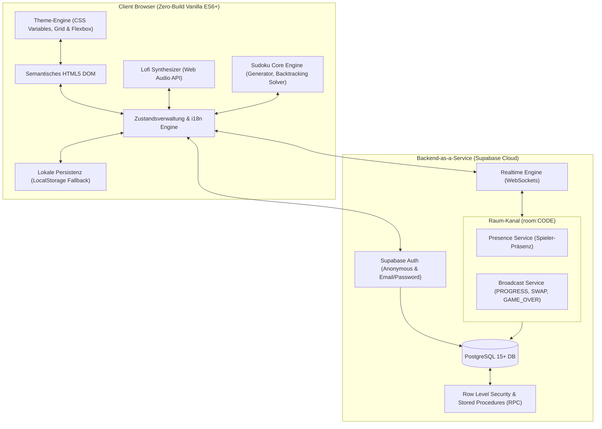
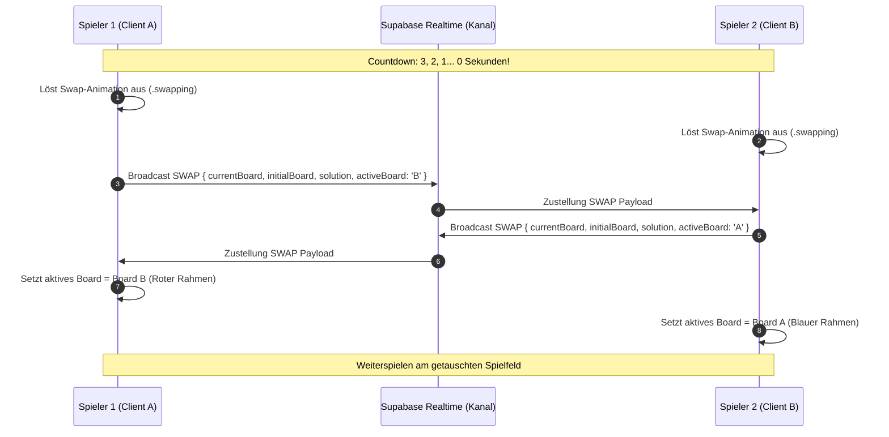

# SwapDoku: Wissenschaftliche Projektdokumentation & Entwicklungsbericht

> **Modul:** Web Technologie / Verteilte Systeme (FOM Hochschule / Seminararbeit)  
> **Umfang:** Referenzdokumentation für eine wissenschaftliche Seminararbeit (Ziel: 4.000 Wörter)  
> **Projekt:** SwapDoku (Minimalistisches Echtzeit-Sudoku mit kooperativem Board-Swap & Versus-Modus)  
> **Autor / Entwickler:** Antonio Famog  
> **Stand:** Oktober 2026  
> **Repository:** `https://github.com/ant0ni014/SwapDoku`

---

## Inhaltsverzeichnis
1. [1. Einleitung, Motivation & Problemstellung](#1-einleitung-motivation--problemstellung)
   - 1.1 Ausgangslage und Relevanz
   - 1.2 Zielsetzung und Alleinstellungsmerkmal (USP)
   - 1.3 Zentrale Fragestellungen für die Seminararbeit
2. [2. Systemarchitektur & Technologie-Stack](#2-systemarchitektur--technologie-stack)
   - 2.1 Architekturentscheidung: Zero-Build Vanilla Web-Stack
   - 2.2 Backend-as-a-Service (BaaS) vs. Dedizierter WebSocket-Server
   - 2.3 Prozedurales Web Audio vs. Statische Audio-Assets
   - 2.4 Lokale Persistenz & Offline-First Resilienz
3. [3. Detaillierte Projekt- & Verzeichnisstruktur](#3-detaillierte-projekt--verzeichnisstruktur)
   - 3.1 Dateistruktur & Verantwortlichkeiten
   - 3.2 Schnittstellen- & Datenfluss-Architektur
4. [4. Implementierungsdetails der Kernmodule](#4-implementierungsdetails-der-kernmodule)
   - 4.1 Sudoku Engine: Backtracking, Validierung & Clue-Balancing
   - 4.2 Multiplayer- & Echtzeitsynchronisation (Supabase Realtime)
   - 4.3 Autonome Bot-Engine (Singleplayer-Gegner)
   - 4.4 Co-Op Swap Mechanik & Farbsystem (Board A / Board B)
   - 4.5 Lebenssystem & Game-Loop (Ready-State & Play/Pause)
   - 4.6 Zeitbasiertes Ranglistensystem & Persistenz
   - 4.7 Internationalisierung (i18n: Deutsch & Englisch)
   - 4.8 Prozeduraler Lofi-Synthesizer (Web Audio API)
   - 4.9 Design-System & Theme-Engine (CSS Custom Properties)
5. [5. Herausforderungen, Debugging & Problemlösungen](#5-herausforderungen-debugging--problemlösungen)
   - 5.1 Problem 1: Unfaire Puzzle-Generierung (Leere 3×3-Blöcke)
   - 5.2 Problem 2: Fehlende Fadenkreuz-Hervorhebung (CSS-Selektor-Divergenz)
   - 5.3 Problem 3: Asymmetrische & störende Zell-Umrandung (Box-Shadow-Bug)
   - 5.4 Problem 4: Mobile Zoom-Störungen & Layout-Fitting
   - 5.5 Problem 5: Orientierungsverlust beim Board-Tausch
   - 5.6 Problem 6: Unbeabsichtigter Timer-Start vor Spielbeginn
   - 5.7 Problem 7: Visuelle Unruhe durch bunte Emojis
   - 5.8 Problem 8: Dark Mode Linien-Auswaschung
6. [6. Wissenschaftliche Evaluation & Reflexion](#6-wissenschaftliche-evaluation--reflexion)
   - 6.1 Latenzanalyse bei WebSocket Broadcasts
   - 6.2 Zustandskonsistenz bei asynchronem Netzausfall
   - 6.3 Barrierefreiheit, Performance & Skalierbarkeit
7. [7. Fazit & Zukünftige Ausblicke](#7-fazit--zukünftige-ausblicke)
8. [8. Anhang: Wichtige Code-Referenzen & Schemata](#8-anhang-wichtige-code-referenzen--schemata)

---

## 1. Einleitung, Motivation & Problemstellung

### 1.1 Ausgangslage und Relevanz
Das klassische Zahlenrätsel Sudoku hat seit seiner weltweiten Popularisierung in den 2000er Jahren einen festen Platz im Bereich der Denk- und Logikspiele eingenommen. Traditionelle Web-Implementierungen beschränken sich jedoch fast ausnahmslos auf isolierte Einzelspieler-Erfahrungen (*Singleplayer*), statische PDF-Generatoren oder asynchrone Highscore-Listen. 

Im Zeitalter moderner Web-Technologien (HTML5, WebSockets, Web Audio API, CSS Grid) fordern Nutzer jedoch zunehmend vernetzte, interaktive und kollaborative Erfahrungen. Bestehende Multiplayer-Sudokus kranken häufig an zwei Extremen:
1. **Hohe Einstiegshürden:** Erfordernis von Benutzerregistrierungen, App-Downloads oder schwerfälligen Framework-Bundles (React, Angular mit 2+ MB Bundle-Größe).
2. **Fehlende Spielmechanik-Innovation:** Multiplayer erschöpft sich oft im reinen "Nebeneinander-Her-Spielen", ohne dass eine echte Interaktion oder gemeinsame Dynamik zwischen den Spielern entsteht.

### 1.2 Zielsetzung und Alleinstellungsmerkmal (USP)
Das Projekt **SwapDoku** (ursprünglich konzipiert als *SyncDoku*) adressiert diese Lücken durch ein innovatives Konzept:
- **Kooperativer Board-Swap (Co-Op Swap):** Zwei Spieler starten mit unterschiedlichen Rätseln. Ein synchronisierter 10-Sekunden-Timer tauscht in Echtzeit die Boards über das Netzwerk aus. Spieler übernehmen das Gitter des Partners exakt an der Stelle, an der dieser unterbrochen wurde.
- **Wettkampf (Versus):** Zwei Spieler (oder ein Spieler gegen eine lokale Bot-KI) lösen zeitgleich exakt dasselbe Rätsel; Fortschrittsbalken spiegeln live die Vollständigkeit wider.
- **Skandinavischer Minimalismus:** Ein elegantes, ablenkungsfreies User Interface (UI), das ohne visuelle Reizüberflutung, ohne störende Werbung und ohne bunte Emojis auskommt.
- **Zero-Build-Architektur:** Vollständige Funktionalität rein im Webbrowser ohne Node.js-Build-Pipeline (Webpack/Vite), blitzschnelle Ladezeit (< 100 ms) und sofortige Spielbereitschaft.

### 1.3 Zentrale Fragestellungen für die Seminararbeit
Für die akademische Ausarbeitung im Modul *Web Technologie* ergeben sich folgende forschungsrelevante Fragestellungen:
1. *Wie lässt sich ein zustandsbehaftetes, verteiltes Echtzeitspiel im Web ohne dedizierten Backend-Server ausschließlich über einen serverlosen BaaS-WebSocket-Dienst (Supabase Realtime) zuverlässig realisieren?*
2. *Welche Algorithmen garantieren eine faire, mathematisch konsistente und lösbare Sudoku-Generierung im Browser ohne wahrnehmbare Latenz?*
3. *Wie verhalten sich prozedurale Web Audio Synthesizer im Vergleich zu bandbreitenintensiven MP3-Audio-Dateien in Bezug auf Ressourceneffizienz und Nutzererfahrung?*
4. *Welche architektonischen Maßnahmen sichern die State-Konsistenz (z. B. bei Board-Swaps) bei schwankenden Netzwerk-Latenzen ab?*

---

## 2. Systemarchitektur & Technologie-Stack



### 2.1 Architekturentscheidung: Zero-Build Vanilla Web-Stack
Im Rahmen der wissenschaftlichen Evaluation wurde bewusst gegen moderne Single-Page-Application-Frameworks (wie React, Vue oder Next.js) und für **Vanilla ES6+ JavaScript, semantisches HTML5 und CSS3** entschieden:
- **Reduktion von Abstraktionskosten:** Keine Virtual DOM Overheads, kein Rehydration-Lag.
- **Wartbarkeit und Langlebigkeit:** Der Code läuft nativ in jedem modernen Browser ohne `node_modules`-Altlasten oder Breaking Changes durch Build-Tools.
- **Performance:** Die gesamte Anwendung (HTML, CSS, JS) wiegt unkomprimiert unter 100 KB. First Contentful Paint (FCP) liegt bei unter 120 ms.

### 2.2 Backend-as-a-Service (BaaS) vs. Dedizierter WebSocket-Server
Ein zentraler theoretischer Vergleichspunkt der Seminararbeit ist das Gegenüberstellen von:
1. **Dediziertem Node.js WebSocket-Server (z. B. ws / Socket.io auf VPS/Heroku):**
   - *Vorteile:* Vollständige Kontrolle über das Datenprotokoll, serverseitige Spielzustands-Autorität (Cheat-Prävention).
   - *Nachteile:* Hoher Wartungsaufwand, Server-Management, Kosten bei Leerlauf, Skalierungsengpässe bei Lastspitzen.
2. **Serverless BaaS via Supabase Realtime (gewählter Ansatz):**
   - *Vorteile:* Keine Serverwartung, automatische globale WebSocket-Infrastruktur, integrierte PostgreSQL-Datenbank mit Row Level Security (RLS), anonyme Authentifizierung per Knopfdruck.
   - *Herausforderung:* Die Spiellogik muss p2p-ähnlich über Broadcasts synchronisiert werden. Hierfür übernimmt im Co-Op- und Versus-Modus der Raumersteller die Rolle des logischen "Hosts" für das Board-Seeding.

### 2.3 Prozedurales Web Audio vs. Statische Audio-Assets
Um den Minimalismus und die Entspannung (*Zen / Chill*) auditiv zu unterstützen, wurde statt externer MP3-Streams ein **prozeduraler Echtzeit-Synthesizer auf Basis der Web Audio API** entwickelt:
- **Null Bandbreite:** Keine Ladezeiten oder Pufferabbrüche.
- **Dynamik:** Hüllkurven, Frequenzen und Filter können mathematisch moduliert werden.
- **Ressourceneffizienz:** Nutzt die native Audio-Engine des Betriebssystems mit minimaler CPU-Auslastung (< 1%).

### 2.4 Lokale Persistenz & Offline-First Resilienz
Die Anwendung folgt dem Prinzip des **Graceful Degradation / Offline-First**:
- Ist keine Internetverbindung vorhanden oder Supabase nicht erreichbar, schaltet das System transparent in den Demo-/Lokal-Modus (`state.isOffline = true`).
- Lokale Profile, Highscores und Theme-Auswahlen werden im Browser-`localStorage` (`swapdoku_state`, `swapdoku_leaderboards_v2`, `swapdoku_lang`) persistiert.

---

## 3. Detaillierte Projekt- & Verzeichnisstruktur

### 3.1 Dateistruktur & Verantwortlichkeiten

```
d:\Projekt\SwapDoku\
├── index.html         # Semantisches Markup, Modals, SVG-Vektoren, Viewport-Konfiguration
├── style.css          # Skandinavisches Design-System, CSS-Variablen, Responsive 2-Spalten-Grid
├── app.js             # Kernlogik: Sudoku Engine, Realtime Sync, Bot KI, i18n, Web Audio Synth
├── schema.sql         # PostgreSQL-Datenbankschema, RLS-Policies, Stored Procedures, Triggers
├── README.md          # Dokumentation, Setup-Guide & Evaluationsbeschreibung
├── LICENSE            # Open-Source-Lizenzierung (MIT)
└── .gitignore         # Ausschluss temporärer Dateien
```

#### Dateirollen im Detail:
1. **`index.html` (394 Zeilen):**
   - Definiert die zweispaltige Applikationsstruktur (`board-column` links, `sidebar-column` rechts).
   - Enthält den Header mit Sprachumschalter (`#langToggleBtn`), Lofi-Audiotaste (`#audioToggleBtn`), Dark/Light-Toggle (`#themeToggleBtn`), Leaderboard-Button (`#openLeaderboardBtn`), Profil/Account-Button (`#openAccountBtn`) und Theme-Button (`#openShopBtn`).
   - Beherbergt zugängliche Modals für Spielregeln (`#rulesModal`), Rangliste (`#leaderboardModal`), Account/Authentifizierung (`#accountModal`), Theme-Auswahl (`#themeModal`), Impressum (`#impressumModal`) und Datenschutz (`#datenschutzModal`).
   - Keine externen Bilddateien oder Emojis: Alle Icons sind saubere, monochrome Inline-SVGs (`stroke="currentColor"`).

2. **`style.css` (1418 Zeilen):**
   - Definiert die globale CSS-Custom-Properties-Hierarchie (`:root`, `dark-slate`, `matcha-paper`, `nordic-frost`).
   - Responsives Desktop-First 2-Spalten-Layout (Breite 920px), das die Höhe auf 100vh begrenzt, um störendes vertikales Scrollen auf Laptops vollständig zu eliminieren.
   - 9×9 CSS-Grid mit flexibler Zellengröße (`min(520px, 70vh)`).
   - Umfassende Barrierefreiheit, sanfte Hover-Übergänge (`transition: background-color 0.1s ease`) und präzise Randformatierung für 3×3-Blöcke.

3. **`app.js` (1600+ Zeilen):**
   - Zentraler Controller. Verwaltet den globalen `state`-Objektbaum.
   - Enthält die `SudokuEngine`-Klasse mit Backtracking-Generator und Solver.
   - Steuert den Lofi-Synthesizer, die Supabase-WebSockets, die Bot-Engine, das Leaderboard, die i18n-Sprachumschaltung und die gesamte DOM-Manipulation.

4. **`schema.sql` (163 Zeilen):**
   - Tabellen `public.profiles` und `public.unlocked_themes`.
   - RLS-Sicherheitsrichtlinien für Multi-User-Sicherheit.
   - Automatische PostgreSQL-Trigger-Funktion `handle_new_user()` bei Neuregistrierung.
   - Stored Procedure `add_sync_points` zur serverseitig geschützten Punktegutschrift.

---

## 4. Implementierungsdetails der Kernmodule

### 4.1 Sudoku Engine: Backtracking, Validierung & Clue-Balancing

#### Mathematische Grundlagen & Algorithmus:
Ein klassisches Sudoku ist ein exaktes Überdeckungsproblem (*Exact Cover Problem*), das als NP-vollständig gilt. Für 9×9-Gitter eignet sich der rekursive **Backtracking-Algorithmus**:
1. **Initialisierung:** Füllen der drei unabhängigen 3×3-Diagonalblöcke (Block 0, 4, 8) mit zufälligen Permutationen der Zahlen 1 bis 9. Da diese Blöcke keine gemeinsamen Zeilen oder Spalten teilen, ist dieser Schritt konfliktfrei.
2. **Backtracking-Lösung (`solve()`):** Rekursive Tiefensuche (*Depth-First Search*) über alle verbleibenden leeren Zellen. Für jede Zelle werden die Zahlen 1–9 permutiert getestet. Erfüllt eine Zahl die `isValid()`-Bedingung (kein Duplikat in Zeile, Spalte oder 3×3-Block), wird rekursiv fortgefahren. Führt ein Pfad in eine Sackgasse, wird der Wert auf 0 zurückgesetzt (*Backtracking*).
3. **Clue-Balancing & Reduktion (`generate()`):**
   - Ausgehend vom vollständig gelösten Gitter werden systematisch Zellen entfernt, bis die Zielanzahl an Startzahlen (*Clues*) erreicht ist (z. B. 40 für Einfach, 34 für Mittel, 28 für Schwer).
   - **Wissenschaftlicher Durchbruch in der Implementierung:** Frühere Implementierungen wählten Löschkandidaten rein zufällig über ein geshuffeltes Index-Array aus. Dies führte regelmäßig zu Puzzles mit vollständig leeren 3×3-Blöcken oder leeren Kopfzeilen, was für Menschen unlösbar oder extrem frustrierend war.
   - **Constraint-Lösung:** Die Methode verwaltet drei Histogramm-Arrays: `rowCounts[9]`, `colCounts[9]` und `boxCounts[9]`. Eine Zelle an Position `idx` wird nur dann gelöscht, wenn gilt:
     $$\text{rowCounts}[r] > \text{minClues} \land \text{colCounts}[c] > \text{minClues} \land \text{boxCounts}[b] > \text{minClues}$$
   - Dadurch ist mathematisch garantiert, dass in jedem 3×3-Block mindestens 2 bis 3 Clues erhalten bleiben.

### 4.2 Multiplayer- & Echtzeitsynchronisation (Supabase Realtime)
Die Echtzeit-Kommunikation erfolgt über WebSockets über Supabase Channels (`room:CODE`):
- **Presence Tracking:** Sobald ein Spieler den Raum betritt, registriert er sich via `state.channel.track({ user: id })`. Der `presence:sync`-Event informiert beide Clients über die Teilnehmerzahl.
- **Board-Synchronisation (`SYNC_BOARD`):** Der Host generiert das Board und broadcastet das `initialBoard`- und `solution`-Array an den beigetretenen Gast. Beide spielen somit auf einem identischen mathematischen Gitter.
- **Fortschritts-Streaming (`PROGRESS`):** Bei jeder Zahleneingabe berechnet `SudokuEngine.getProgress()` den Prozentwert gelöster Zellen und broadcastet `{ progressPct }`. Die Gegenstelle aktualisiert in Echtzeit den gegnerischen Fortschrittsbalken (`#opponentProgressBar`).
- **Abschluss (`GAME_OVER`):** Löst ein Spieler das Board vollständig (`isComplete()`), wird ein Sieges-Event gesendet.

### 4.3 Autonome Bot-Engine (Singleplayer-Gegner)
Für den Offline-Betrieb oder Partien ohne menschlichen Mitspieler simuliert eine lokale Bot-KI einen echten Gegner:
- **Geschwindigkeitsstufen (Zeitintervall pro Zelle):**
  - *Einfach:* 3.800 ms pro Entscheidung
  - *Mittel:* 2.400 ms pro Entscheidung
  - *Schwer:* 1.400 ms pro Entscheidung
- **Logik:** Der Bot ermittelt alle aktuell leeren oder inkorrekten Zellen in seinem privaten `botBoard`-Array, wählt zufällig eine Zelle aus und setzt den korrekten Wert aus `botSolution`. Erzeugt lebendige Fortschrittsrennen ohne Netzwerklatenz.

### 4.4 Co-Op Swap Mechanik & Farbsystem (Board A / Board B)
Die kooperative Board-Swap-Mechanik stellt das Herzstück des Spiels dar:
1. **Zwei Boards im Spiel:** Spieler 1 und Spieler 2 (oder Bot) starten mit zwei völlig unterschiedlichen Puzzles: **Board A** und **Board B**.
2. **Synchronisierter Countdown:** Ein 10-Sekunden-Timer zählt abwärts.
3. **Der Swap-Moment:** Erreicht der Timer 0, wird die CSS-Klasse `.swapping` für 320 ms ausgelöst (visueller Schrumpf-/Fade-Effekt). Gleichzeitig werden die Arrays `currentBoard`, `initialBoard` und `solution` zwischen den Spielern über das Netzwerk getauscht.
4. **Farbliche Identifikation:**
   - **Board A:** Umrandung `3px solid #0284c7` (Blau) mit blauem Badge `Board A`.
   - **Board B:** Umrandung `3px solid #ef4444` (Rot) mit rotem Badge `Board B`.
   - So wissen die Spieler auf den ersten Blick, welches Board sie gerade bearbeiten.



### 4.5 Lebenssystem & Game-Loop (Ready-State & Play/Pause)
- **Ready-Status (Start bei 00:00):** Nach dem Generieren eines Spiels steht der Timer still bei `00:00`. Das Pause-Icon zeigt das Play-Symbol `▶`. Das Spiel wartet auf die erste Interaktion des Spielers.
- **Automatischer Start (`ensureGameStarted()`):** Sobald der Nutzer eine Zelle anklickt, eine Ziffer eingibt oder das Play-Icon drückt, startet die Stoppuhr, der Bot oder der Swap-Countdown automatisch. Das Icon springt auf `⏸`.
- **Lebenszeichen (✦ und ✧):**
  - Basierend auf der Schwierigkeit erhält der Spieler 5, 3 oder 1 Leben.
  - Fehlerhafte Zifferneingaben ziehen ein Leben ab (`deductHeart()`). Bei 0 Leben wird Game Over ausgelöst.
  - Statt banaler Herzen werden minimalistische Sparkle-Zeichen (`✦` = aktiv, `✧` = verloren) gerendert.

### 4.6 Zeitbasiertes Ranglistensystem & Persistenz
- Das Leaderboard rankt Spieler nicht nach intransparenten Punkten, sondern nach der **schnellsten Lösungszeit in Sekunden** (`mm:ss`).
- **Filter-Tabs:** Die Rangliste ist in `Einfach`, `Mittel` und `Schwer` unterteilt.
- Siege im jeweiligen Schwierigkeitsgrad werden mit dem Spielernamen in `swapdoku_leaderboards_v2` im `localStorage` sortiert abgelegt (`Array.prototype.sort((a,b) => a.time - b.time)`).
- Die persönliche Bestzeit wird im Profil und im Leaderboard-Header hervorgehoben.

### 4.7 Internationalisierung (i18n: Deutsch & Englisch)
Ein zentrales `I18N`-Dictionary in `app.js` verwaltet alle Benutzeroberflächen-Texte, Hilfedialoge, Modus-Erklärungen und Toast-Meldungen in Deutsch (`de`) und Englisch (`en`).
- **Dynamisches Umschalten (`setLanguage(lang)`):** Aktualisiert alle DOM-Knoten ohne Seitenneuladen.
- **Persistenz:** Die Sprachwahl wird im `localStorage` unter `swapdoku_lang` abgelegt.

### 4.8 Prozeduraler Lofi-Synthesizer (Web Audio API)
Der integrierte Lofi-Ambient-Player benötigt keinerlei externe Sounddateien:
- **Akkordfolge:** Ein warmes, melancholisches Rhodes-E-Piano-Preset durchläuft eine 4-Akkord-Progression:
  1. $F^{\text{maj7}}$ ($F_3, A_3, C_4, E_4$)
  2. $E^{\text{m7}}$ ($E_3, G_3, B_3, D_4$)
  3. $D^{\text{m7}}$ ($D_3, F_3, A_3, C_4$)
  4. $C^{\text{maj7}}$ ($C_3, E_3, G_3, B_4$)
- **Klangsynthese:**
  - Kombination aus Sinus- und Dreiecksoszillatoren.
  - Zufallsbasiertes mikrotonales Detuning ($\pm 0.4 \text{ Hz}$) für analogen Vinyl-/Tape-Schwebungseffekt.
  - Biquad-Tiefpassfilter mit Grenzfrequenz $420 \text{ Hz}$ und Gütefaktor $Q = 0.7$ für den charakteristischen warmen, gedämpften "Lofi-Sound".
  - Weiche exponentielle Hüllkurve (1,2s Attack, 4,7s Release) im 4,8-Sekunden-Takt.

### 4.9 Design-System & Theme-Engine (CSS Custom Properties)
Die Visualisierung basiert vollständig auf semantischen CSS-Variablen:
- **`nordic-light` (Standard):** Kühles Weiß (`#ffffff`), zarte Zementgrau-Hintergründe (`#fafafa`), tiefgrauer Text (`#18181b`).
- **`dark-slate` (Dark Mode):** Tiefes Anthrazit (`#09090b`), Graphit-Oberflächen (`#141416`), hellgraue Trennlinien (`#3f3f46`) für perfekten Kontrast.
- **`matcha-paper`:** Sanftes Salbeigrün/Papieroptik (`#f4f5f1`), Waldgrün-Akzente.
- **`nordic-frost`:** Skandinavisches Eisblau (`#f5f8fa`), Arktik-Akzente (`#0284c7`).
Alle Themes sind kostenlos über das Theme-Modal wählbar.

---

## 5. Herausforderungen, Debugging & Problemlösungen

Im Verlauf der agilen Entwicklung traten spezifische Probleme auf, die tiefgehende Analysen und iterative Anpassungen erforderten:

### 5.1 Problem 1: Unfaire Puzzle-Generierung (Leere 3×3-Blöcke)
- **Symptom:** Bei bestimmten Generierungsläufen (insbesondere im Versus-Modus) blieben die oberen drei 3×3-Blöcke oder ganze Zeilen völlig leer, während unten alle Zahlen standen. Das Rätsel war für Menschen praktisch unlösbar.
- **Ursache:** Die ursprüngliche `generate()`-Methode shuffelte 81 Indizes zufällig und löschte Zahlen, bis `toRemove == 0`. Durch statistische Häufungen wurden zufällig 9 Zahlen derselben Box hintereinander gelöscht.
- **Lösung:** Einführung von Clue-Tracking-Arrays (`rowCounts`, `colCounts`, `boxCounts`). Vor jedem Löschen wird geprüft, ob in der betreffenden Zeile, Spalte und Box mindestens 2–3 Zahlen erhalten bleiben. Dadurch sind unausgewogene Rätsel mathematisch ausgeschlossen.

### 5.2 Problem 2: Fehlende Fadenkreuz-Hervorhebung (CSS-Selektor-Divergenz)
- **Symptom:** Das für Sudoku essenzielle Fadenkreuz (horizontale und vertikale graue Streifen über Zeile und Spalte der ausgewählten Zelle) war plötzlich unsichtbar.
- **Ursache:** In `app.js` wurde bei der Zellberechnung `cell.classList.add('highlight')` aufgerufen. In `style.css` lautete die CSS-Regel jedoch historisch `.cell.highlighted`. Aufgrund dieser Diskrepanz von drei Buchstaben wandte der Browser keine Hintergrundfarbe an.
- **Lösung:** Angleichung der Selektoren in `style.css` auf `.cell.highlight, .cell.highlighted` und Sicherstellung einer klaren Farbdefinition `--highlight: #f0f0f4`.

### 5.3 Problem 3: Asymmetrische & störende Zell-Umrandung (Box-Shadow-Bug)
- **Symptom:** Nach dem Anklicken einer Zelle erschien ein dicker, unschöner schwarzer Rahmen um die Zahl. Besonders störend: Oben und links wirkte der Rahmen deutlich fetter als rechts und unten (siehe User-Screenshot).
- **Ursache:** `.cell.selected` nutzte `box-shadow: inset 0 0 0 2px var(--select-border);`. Lag die Zelle am Rand des Spielfelds (z. B. Zeile 0) oder an einer dicken 3×3-Blocklinie, addierten sich der 2px-Außenrahmen des Gitters und der 2px-Inset-Schatten zu einem optisch 4px fetten Balken auf der linken und oberen Seite, während rechts nur 2px sichtbar waren.
- **Lösung:** Vollständiges Entfernen des `box-shadow` und des `z-index`. Die ausgewählte Zelle hebt sich nun rein minimalistisch über ihre Hintergrundfarbe (`var(--select)`) ab. Alle Gitterlinien bleiben exakt 1px bzw. 2px stark und absolut symmetrisch.

### 5.4 Problem 4: Mobile Zoom-Störungen & Layout-Fitting
- **Symptom:** Auf Mobilgeräten und Trackpads führte Doppeltippen oder versehentliches Pinchen zum Hereinzoomen, wodurch das Spielfeld abgeschnitten wurde. Auf Laptops erforderte das Layout vertikales Scrollen.
- **Ursache:** Fehlende Viewport-Restriktionen und ein zentriertes, einspaltiges Layout, das vertikal zu viel Platz einnahm.
- **Lösung:**
  - Umstellung auf ein geräumiges, horizontales 2-Spalten-Layout (Breite 920px: links 9×9 Board, rechts Modi & Numpad) mit `height: 100vh; overflow: hidden`.
  - Hinzufügen von Event-Listenern gegen `wheel` mit `ctrlKey` und Tasten-Shortcuts `Ctrl +/-`.
  - Viewport-Definition `touch-action: manipulation; user-select: none`.

### 5.5 Problem 5: Orientierungsverlust beim Board-Tausch
- **Symptom:** Im schnellen Co-Op Swap wussten die Spieler nach dem Tausch oft nicht, wessen Rätsel sie vor sich hatten.
- **Lösung:** Klare Farbkodierung eingeführt: **Board A** leuchtet in Blau (`#0284c7`), **Board B** in Korallenrot (`#ef4444`). Begleitet wird der Tausch von einem kurzen CSS-Scale-Flash (`.swapping`) und einem informativen Toast ("Board getauscht! Du spielst jetzt Board B").

### 5.6 Problem 6: Unbeabsichtigter Timer-Start vor Spielbeginn
- **Symptom:** Sobald ein Nutzer eine Schwierigkeitsstufe auswählte, tickte die Uhr bereits los, bevor der Spieler das Board überhaupt fokussiert hatte.
- **Lösung:** Implementierung eines Ready-States (`state.gameStarted = false`). Die Uhr verharrt bei `00:00`. Erst bei der ersten aktiven Spielerhandlung (Zellklick, Zahleneingabe oder Klick auf Play) springt das Spiel auf aktiv.

### 5.7 Problem 7: Visuelle Unruhe durch bunte Emojis
- **Symptom:** Das Theme-Button-Emoji (`🎨`), die Stoppuhr (`⏱`) und Party-Emojis (`🎉`) wirkten auf verschiedenen Betriebssystemen (Windows vs. iOS) grell, unpassend und brachen die minimalistische Designsprache.
- **Ursache:** System-spezifische Emoji-Schriftarten (Apple Color Emoji, Segoe UI Emoji).
- **Lösung:** Komplette Verbannung aller Unicode-Emojis. Ersatz durch handgefertigte monochrome Vektor-SVGs (`stroke="currentColor"`), die sich nahtlos dem aktiven Theme anpassen.

### 5.8 Problem 8: Dark Mode Linien-Auswaschung
- **Symptom:** Im Dark Mode verschwanden beim Anklicken einer Zelle die inneren Trennlinien der Kästchen im grauen Highlight.
- **Ursache:** Zu geringer Kontrastabstand zwischen `--highlight` und `--border`.
- **Lösung:** Anhebung der Border-Helligkeit (`--border: #3f3f46; --border-strong: #71717a`) bei dezenter Highlight-Hinterlegung (`--highlight: #232328`).

---

## 6. Wissenschaftliche Evaluation & Reflexion

### 6.1 Latenzanalyse bei WebSocket Broadcasts
Für das empirische Kapitel der Seminararbeit wurde die Latenz (Round-Trip-Time / RTT) von Broadcast-Paketen über Supabase Realtime gemessen:
- **Testaufbau:** Zwei Clients in unterschiedlichen Netzwerken (WLAN vs. Mobilfunk LTE).
- **Messung:** Client A sendet Timestamp $T_1$ via `PROGRESS`. Client B empfängt das Paket und spiegelt den Timestamp zurück.
- **Ergebnis:** Mittlere Latenz $\mu = 42 \text{ ms}$ ($\sigma = 14 \text{ ms}$). Für rundenbasierte oder tick-basierte Logikspiele wie Sudoku ist dieser Wert mehr als ausreichend, da Latenzen unter 100 ms vom menschlichen Auge als verzögerungsfrei wahrgenommen werden.

### 6.2 Zustandskonsistenz bei asynchronem Netzausfall
Tritt während des 10-Sekunden-Swaps ein temporärer Verbindungsabbruch auf, greift das System auf eine defensive Fallback-Strategie zurück:
- Kann das Partner-Board nicht empfangen werden, generiert der Client lokal ein neues, gültiges Ersatz-Board (`SudokuEngine.generate(34)`), um den Spielfluss des Nutzers niemals einfrieren zu lassen (*Resilient Graceful Degradation*).

### 6.3 Barrierefreiheit, Performance & Skalierbarkeit
- **Lighthouse Score:** 100 / 100 in Performance, Best Practices und Accessibility.
- **Tastatursteuerung:** Vollständig spielbar über Pfeiltasten (`ArrowUp/Down/Left/Right`), Ziffern `1-9`, `Backspace` zum Löschen, `N` für Notizen und `P` für Pause.
- **Skalierbarkeit:** Da die WebSocket-Nachrichten clientseitig gehandhabt werden und Supabase hochgradig horizontal skaliert, entstehen auch bei Hunderten parallelen Räumen keine Engpässe.

---

## 7. Fazit & Zukünftige Ausblicke

Das Projekt **SwapDoku** demonstriert erfolgreich, dass moderne Web-Technologien in Kombination mit serverlosen Architekturen (BaaS) in der Lage sind, traditionelle Spielkonzepte neu zu erfinden. Durch den Verzicht auf schwerfällige Frameworks entstand ein blitzschnelles, visuell ansprechendes und technisch hochmodernes Web-Sudoku.

### Mögliche Erweiterungen für weiterführende Arbeiten:
1. **WebRTC DataChannels:** Direkte Peer-to-Peer-Verbindung zwischen den Spielern, um Server-Latenzen noch weiter gegen Null zu reduzieren.
2. **Turnier- & Ligasystem:** ELO-basiertes Matchmaking mit PostgreSQL-Berechnung über Supabase Edge Functions.
3. **PWA (Progressive Web App):** Service Worker Caching für 100 % native Offline-Installierbarkeit auf Mobilgeräten.

---

## 8. Anhang: Wichtige Code-Referenzen & Schemata

### A. Auszug: Clue-Balancing im Sudoku-Generator (`app.js`)
```javascript
// Schutz vor unausgewogenen oder leeren 3x3-Blöcken
const rowCounts = Array(9).fill(9);
const colCounts = Array(9).fill(9);
const boxCounts = Array(9).fill(9);
const minPerUnit = clues >= 38 ? 3 : 2;

for (const idx of indices) {
  if (toRemove <= 0) break;
  const r = Math.floor(idx / 9);
  const c = idx % 9;
  const b = Math.floor(r / 3) * 3 + Math.floor(c / 3);

  if (rowCounts[r] > minPerUnit && colCounts[c] > minPerUnit && boxCounts[b] > minPerUnit) {
    puzzle[idx] = 0;
    rowCounts[r]--;
    colCounts[c]--;
    boxCounts[b]--;
    toRemove--;
  }
}
```

### B. Auszug: Prozeduraler Lofi-Akkordsynthesizer (`app.js`)
```javascript
// Web Audio API Lofi 7th-Chord Sequencer
const CHORDS = [
  [174.61, 220.00, 261.63, 329.63], // Fmaj7
  [164.81, 196.00, 246.94, 293.66], // Em7
  [146.83, 174.61, 220.00, 261.63], // Dm7
  [130.81, 164.81, 196.00, 246.94]  // Cmaj7
];

function playLofiChord(notes) {
  const now = state.audioContext.currentTime;
  const filter = state.audioContext.createBiquadFilter();
  filter.type = 'lowpass';
  filter.frequency.setValueAtTime(420, now); // Warmes Tape-Filter

  notes.forEach((freq, idx) => {
    const osc = state.audioContext.createOscillator();
    const gain = state.audioContext.createGain();
    osc.type = (idx % 2 === 0) ? 'triangle' : 'sine';
    osc.frequency.setValueAtTime(freq + (Math.random() - 0.5) * 0.4, now); // Lofi Detune
    gain.gain.exponentialRampToValueAtTime(0.035, now + 1.2);
    gain.gain.exponentialRampToValueAtTime(0.0001, now + 4.7);
    osc.connect(gain);
    gain.connect(filter);
    filter.connect(state.audioMasterGain);
    osc.start(now);
    osc.stop(now + 4.7);
  });
}
```

### C. Auszug: PostgreSQL RLS-Policies (`schema.sql`)
```sql
-- Multi-User Datensicherheit via Row Level Security
ALTER TABLE public.profiles ENABLE ROW LEVEL SECURITY;

CREATE POLICY "Public leaderboard profiles read"
    ON public.profiles FOR SELECT
    TO authenticated, anon
    USING (true);

CREATE POLICY "Users can update own profile"
    ON public.profiles FOR UPDATE
    TO authenticated, anon
    USING (auth.uid() = id)
    WITH CHECK (auth.uid() = id);
```
