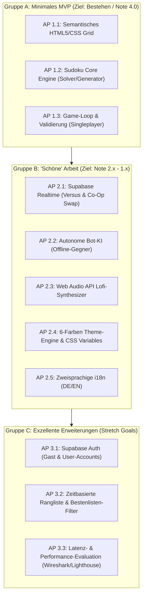

# Projektskizze zur Semesterarbeit

**Thema:** SwapDoku — Konzeption und Implementierung einer echtzeitfähigen, kollaborativen Web-Sudoku-Plattform auf Basis moderner Web-Standards und serverloser BaaS-Architektur  
**Untertitel:** Eine performante, barrierearme Single-Page-Application (SPA) mit innovativem Co-Op Board-Swap, Versus-Modus und prozeduraler Audio-Synthese  
**Modul:** Web Technologie / Verteilte Systeme  
**Autor:** Antonio Famog  
**Abgabedatum Skizze (Forum):** 06.11.2026  
**Zielumfang der Ausarbeitung:** ca. 4.000 Wörter (inkl. lauffähigem Praxis-Artefakt)  
**Repository & Live-Code:** [https://github.com/ant0ni014/SwapDoku](https://github.com/ant0ni014/SwapDoku)

---

## 1. Executive Summary & Pitch (Überzeugungsargument)

Klassische Sudoku-Webanwendungen sind seit über zwei Jahrzehnten auf isolierte Einzelspieler-Erfahrungen, statische PDF-Exporte oder asynchrone Highscore-Listen beschränkt. Zeitgenössische Web-Standards bieten jedoch alle Voraussetzungen für hochdynamische, vernetzte und kollaborative Erlebnisse – ohne dabei auf ressourcenhungrige JavaScript-Frameworks (React, Angular) oder komplexe Node.js-Server-Cluster zurückgreifen zu müssen.

**SwapDoku** schließt diese Marktlücke durch eine leichtgewichtige, installationsfreie Web-Applikation, die traditionelles Logikrätseln mit innovativen Multiplayer-Mechaniken kombiniert:
1. **Kooperativer Board-Swap (Co-Op Swap):** Zwei räumlich getrennte Spieler tauschen über einen synchronisierten Timer in Echtzeit ihre Spielfelder und lösen das Rätsel des Partners nahtlos weiter.
2. **Echtzeit-Versus:** Direkter Wettkampf gegen menschliche Mitspieler oder eine adaptive Bot-KI mit synchronen Fortschrittsbalken.
3. **Zero-Build & Zero-Asset-Architektur:** Lauffähig direkt im Browser ohne Node.js-Buildschritt, Ladezeit < 100 ms, prozedurale Klangerzeugung via Web Audio API statt speicherintensiver MP3s.

Dieses Vorhaben demonstriert par excellence die zentralen Lehrinhalte des Moduls *Web Technologie*: Clientseitiges State-Management, asynchrone WebSocket-Kommunikation, mathematische Backtracking-Algorithmen, CSS-Grid-Layouts und modernste Browser-APIs. Die technische Machbarkeit ist durch Prototypen vollständig plausibilisiert und stellt ein hervorragendes Fundament für eine exzellente Semesterarbeit dar.

---

## 2. Problemstellung und Praxisrelevanz

### 2.1 Ausgangslage & Marktanalyse
Obwohl Sudoku weltweit täglich von Millionen Menschen gespielt wird, existieren kaum zeitgemäße Web-Lösungen mit echter Kollaboration:
- **Framework-Overhead:** Moderne Webspiele laden häufig mehrere Megabyte an JavaScript-Bundles herunter, was auf mobilen Endgeräten zu spürbaren Rucklern und Verzögerungen beim First Contentful Paint (FCP) führt.
- **Mangelnde Spielmechanik-Innovation:** Bestehende Multiplayer-Ansätze erschöpfen sich im nebeneinander her laufenden Stoppuhr-Vergleich ohne direkte spielerische Interaktion.
- **Einstiegshürden:** Native Apps fordern App-Store-Downloads, Kontenzwang und monetarisieren aggressiv mit Fullscreen-Werbung.

### 2.2 Praxisrelevanz & Lerneffekt
Das Projekt adressiert zentrale Herausforderungen moderner Softwaretechnik im Web:
- **Ressourceneffizienz:** Wie viel Funktionalität lässt sich mit purem Vanilla JavaScript (ES6+), semantischem HTML5 und CSS Custom Properties erzielen?
- **Serverless Realtime Architecture:** Wie können Echtzeit-Spiele über Backend-as-a-Service (Supabase Realtime WebSockets) skaliert werden, ohne eigene Serverinfrastruktur warten zu müssen?
- **Algorithmen & Heuristiken im Frontend:** Ausführung deterministischer Backtracking-Generatoren und Validatoren innerhalb des browserseitigen Event-Loops bei 60 FPS.

---

## 3. Angestrebtes Ergebnis (Deliverable)

Das finale Ergebnis der Semesterarbeit gliedert sich in zwei eng verzahnte Bestandteile:
1. **Das funktionale Web-Artefakt (Software):**
   - Eine produktiv gehostete, responsive Web-App (Single-Page-Application), die auf Desktop-, Tablet- und Smartphone-Browsern uneingeschränkt nutzbar ist.
   - Drei vollwertige Spielmodi: Einzelspieler (Zen), Versus (Online & Bot) und Co-Op Swap.
   - Vollständige Offline-Fähigkeit für Einzelspieler mittels LocalStorage-Persistenz.
   - Integrierter, mathematisch synthetisierter Lofi-Soundtrack (Web Audio API) und ein 6-stufiges Design-Theme-System.
2. **Die wissenschaftliche Ausarbeitung (Schriftlicher Bericht, ca. 4.000 Wörter):**
   - Eine fundierte Dokumentation nach wissenschaftlichen Standards, welche Architektur, Algorithmen, Latenzmessungen, Herausforderungen und Best Practices im Web Engineering reflektiert.

---

## 4. Ziele und Nutzen nach den SMART-Kriterien

* **S (Spezifisch):**  
  Entwicklung und wissenschaftliche Evaluation einer zustandsbehafteten Echtzeit-Webanwendung für kollaboratives Sudoku unter Verwendung moderner nativer Webstandards (HTML5, CSS Grid/Flexbox, ES6+ Modules, Web Audio API) und eines serverlosen BaaS-WebSocket-Backends (Supabase).
* **M (Messbar):**  
  - **Performance:** First Contentful Paint (FCP) < 300 ms, Google Lighthouse Score > 95 in Performance, Accessibility und Best Practices.
  - **Latenz:** WebSocket-Synchronisationsdauer für Spielfeld-Zustände < 80 ms im mitteleuropäischen Raum.
  - **Code-Qualität:** 0 Build-Abhängigkeiten (Zero-Build-Architektur), modularer Code mit klarer Trennung von Logik, State und DOM-Rendering.
  - **Umfang:** Schriftliche Ausarbeitung mit mindestens 4.000 Wörtern, vollständiger Quellcode auf GitHub.
* **A (Akzeptiert & Attraktiv):**  
  Niedrigschwelliger Einstieg für Nutzer (kein Download, optionaler Gast-Modus, keine Werbung, freie Themes) und hoher Erkenntnisgewinn für die akademische Begutachtung im Modul Web Technologie.
* **R (Realistisch):**  
  Die technische Machbarkeit von Backtracking-Algorithmen und WebSocket-Broadcasting im Browser ist erwiesen. Durch den Verzicht auf schwere Frameworks bleibt der Projektumfang für eine Einzelperson innerhalb des Semesterrahmens präzise beherrschbar.
* **T (Terminiert):**  
  - 06.11.2026: Einreichung und Peer-Feedback der Projektskizze im Hochschulforum.
  - 30.11.2026: Fertigstellung des Kern-MVP (Gruppe A).
  - 31.12.2026: Abschluss der Multiplayer- & Audio-Implementierung (Gruppe B).
  - 20.01.2027: Abschluss der empirischen Tests, Messungen und Schriftfassung (ca. 4.000 Wörter).
  - Finale Abgabe gemäß offiziellem Prüfungsplan.

---

## 5. Scope: Umfang, Leistung und Qualitätskriterien

### In-Scope (Leistungsumfang)
- **Sudoku-Engine:** Generierung gültiger, symmetrisch balancierter 9×9-Gitter mit garantierter eindeutiger Lösbarkeit über Backtracking; drei adaptive Schwierigkeitsgrade (*Einfach*, *Mittel*, *Schwer*).
- **Zustandsverwaltung:** Zentraler State Store für Gitterzustände, Notizen-Ebene (Pencil Marks), Ziffernkontingente und Zeitmessung.
- **Echtzeit-Synchronisation:** Raum-basierte Multiplayer-Sessions mit 4-stelligem Code via Supabase Realtime Channels (Presence & Broadcast).
- **UI/UX & Barrierefreiheit:** Skandinavisches Design-System mit 6 Kontrast-Themes (inkl. OLED-Darkmode), vollständige Tastatursteuerung (Pfeiltasten, Ziffern 1–9, Notizen-Toggle, Pause), responsive Anpassung für Smartphones.
- **Audio-Synthese:** Eigenständige Klangsynthese im Browser via Web Audio API (Oszillatoren, Biquad-Filter, Gain-Hüllkurven).

### Out-of-Scope (Abgrenzung zur Komplexitätsreduktion)
- Native Mobile-Apps (iOS/Android im App Store) – Fokus liegt rein auf Standards des Open Web.
- Monetarisierung, In-App-Käufe oder Zahlungsabwicklungen (alle Features sind 100 % kostenfrei).
- Eigener Linux-Rootserver mit Node.js/Socket.io – bewusst durch serverloses BaaS (Supabase) ersetzt, um Wartungsaufwände zu eliminieren.

### Qualitätskriterien
- **Resilienz:** Bei kurzzeitigem Verbindungsabbruch geht der Spielstand nicht verloren (Reconnection-Strategie & LocalStorage-Backup).
- **Usability:** Keine störenden visuellen Elemente (keine bunten Emojis, dezente monochrome Vektor-SVGs, saubere Fadenkreuz-Hervorhebung für Zeilen und Spalten).
- **Datenschutz:** DSGVO-konforme Datenhaltung (Gastmodus ohne Personenbezug, minimale Speicherung bei E-Mail-Registrierung).

---

## 6. Strukturierung der Arbeitspakete (3-Stufen-Modell)

Um den Anforderungen der Prüfungsordnung und einem professionellen Risikomanagement gerecht zu werden, sind die Arbeitspakete in drei Ausbaustufen unterteilt:

### Gruppe A: Minimales Set von Arbeitspaketen (MVP — Ziel: Gerade so bestehen)
*Dieses Set sichert die Basisanforderungen einer funktionierenden Web-Anwendung und einer geschlossenen theoretischen Arbeit ab.*
* **AP 1.1: Semantische UI & Responsive Grid:** Aufbau der Benutzeroberfläche mit HTML5 und CSS Grid/Flexbox zur korrekten Darstellung eines 9×9-Sudokufelds auf Desktop und Mobilgeräten.
* **AP 1.2: Sudoku-Algorithmus:** Implementierung eines Backtracking-Algorithmus in JavaScript zur Prüfung der Spielfeldvalidität und Erzeugung lösbarer Gitter.
* **AP 1.3: Interaktive Spielmechanik:** Eingabe von Zahlen, Fehlerüberprüfung, Zählung verbleibender Ziffern, Stoppuhr und grundlegendes Gewonnen/Verloren-Feedback.
* **Theoretischer Teil A:** Dokumentation von Web-Grundlagen, DOM-Manipulation und Algorithmen-Komplexität (Landau-Symbole des Solvers).

### Gruppe B: Weitere Arbeitspakete für eine "schöne", vollwertige Arbeit (Ziel: Note 2.x bis 1.x)
*Diese Pakete heben das Projekt auf ein überdurchschnittliches akademisches und praktisches Niveau.*
* **AP 2.1: Echtzeit-Multiplayer via Supabase:** Einbindung von WebSockets über Supabase Realtime Channels. Implementierung der Synchronisation für den Versus-Fortschritt und den kooperativen Board-Swap.
* **AP 2.2: Autonome Bot-Engine:** Entwicklung eines browserseitigen KI-Gegners mit menschlichem Lösungsverhalten (zufallsgesteuerte menschliche Bedenkzeit, Fehlerrate je nach Stufe).
* **AP 2.3: Synthetisierte Sound-Engine:** Implementierung eines prozeduralen Audio-Synthesizers mit der Web Audio API für Lofi-Ambient-Musik und taktiles akustisches Feedback.
* **AP 2.4: Theme-Engine & Scandinavian Minimalist UI:** Dynamisches Farbsystem mit 6 distinkten Farbwelten (Nordic Light, Dark Slate, Matcha Green, Ocean Frost, Sunset Amber, Lavender Dream) via CSS Custom Properties.
* **AP 2.5: Internationalisierung (i18n):** Clientseitige Umschaltung zwischen Deutsch und Englisch ohne Neuladen der Seite.
* **Theoretischer Teil B:** Analyse von BaaS vs. Self-Hosted WebSockets, Latenzvergleich und Synthese vs. Streaming im Web.

> **Begründungsstrategie bei Nicht-Realisierung einzelner APs aus Gruppe B:**  
> Sollten unvorhersehbare Hürden auftreten (z. B. Überschreitung von Supabase-Free-Tier-Quotas oder unlösbare Web-Audio-Inkompatibilitäten auf exotischen Browsern), greifen definierte Fallback-Mechanismen:  
> - Der Multiplayer weicht nahtlos auf die autonome Bot-Engine aus (vollständige Offline-Spielbarkeit garantiert).  
> - Die Sound-Engine lässt sich über ein "Silent Graceful Degradation"-Muster deaktivieren, ohne die Spielbarkeit zu beeinträchtigen.  
> Diese Vorkehrungen werden in der Semesterarbeit wissenschaftlich als architektonische Resilienz begründet.

### Gruppe C: Zusätzliche Erweiterungen (Stretch Goals / Exzellenz)
*Optionale Vertiefungen für eine herausragende wissenschaftliche Leistung.*
* **AP 3.1: Authentifizierung & Cloud-Profile:** Anbindung von Supabase Auth (Passwort-Registrierung & anonymer Gastzugang) zur Synchronisation persönlicher Statistiken.
* **AP 3.2: Zeitbasierte Ranglisten-Filter:** Globale Bestenliste mit filterbaren Schwierigkeitsgraden und Sortierung nach Lösungszeit.
* **AP 3.3: Empirische Latenz- und Performance-Analyse:** Systematische Messreihen der WebSocket-Roundtrip-Time (RTT) unter simulierter Netzwerkdrosselung (3G/4G) und Auswertung für die Seminararbeit.

---

## 7. Zeit-, Ressourcen- und Aufwandsplanung

Für die Durchführung der Semesterarbeit wird ein studentischer Gesamtaufwand von ca. **140 Arbeitsstunden** (Personenstunden) veranschlagt:

| Phase | Zeitraum | Inhalt / Meilensteine | Geplanter Aufwand |
| :--- | :--- | :--- | :--- |
| **Phase 1: Konzeption & Skizze** | Bis 06.11.2026 | Anforderungsanalyse, Systemarchitektur, Einreichung der Projektskizze | 15 h |
| **Phase 2: MVP-Entwicklung (Gruppe A)** | 07.11. – 25.11.2026 | HTML/CSS-Skelett, Backtracking-Solver, Singleplayer Game Loop | 35 h |
| **Phase 3: Multiplayer & Audio (Gruppe B)**| 26.11. – 20.12.2026 | Supabase Realtime, Co-Op Swap, Bot-KI, Web Audio API, Themes | 40 h |
| **Phase 4: Testen, Refactoring & Messung**| 21.12. – 05.01.2027 | Cross-Browser-Tests (Chrome, Safari, Firefox, Mobile), RTT-Messungen | 15 h |
| **Phase 5: Schriftliche Ausarbeitung** | 06.01. – 25.01.2027 | Verfassen der wissenschaftlichen Arbeit (4.000 Wörter), Peer-Review | 35 h |
| **Gesamtaufwand:** | | | **140 Stunden** |

---

## 8. Risiken, Auswirkungen und Mitigationsstrategien

| Risiko | Wkt. | Auswirkung | Präventive Gegenmaßnahme (Mitigation) |
| :--- | :--- | :--- | :--- |
| **R1: Verbindungsabbrüche bei WebSockets** | Mittel | Hoch | Implementierung eines Heartbeat-Pings, Reconnection-Handshake und lokaler Zwischenspeicherung im `localStorage`. |
| **R2: Latenzbedingte Desynchronisation beim Board-Swap** | Mittel | Hoch | Zeitstempel-basierte Synchronisation über Presence-State; deterministischer Swap-Timer, der clientseitig vorausberechnet wird. |
| **R3: Hohe Rechenlast beim Puzzle-Generieren** | Niedrig | Mittel | Optimierter Backtracking-Algorithmus mit zufälliger Zeilen-Permutation; Generierung benötigt < 15 ms, blockiert den Event-Loop nicht. |
| **R4: Audio-Autoplay-Blockaden moderner Browser** | Hoch | Niedrig | Initialisierung des `AudioContext` erst nach expliziter Benutzerinteraktion (Klick auf Musik-Button) gemäß W3C-Spezifikation. |
| **R5: Zeitverzug bei der schriftlichen Dokumentation** | Mittel | Mittel | Frühzeitiges Führen eines Entwicklungstagebuchs und paralleles Verschriftlichen der Architektur-Kapitel während der Implementierung. |

---

## 9. Vorläufiger Gliederungsvorschlag für die Semesterarbeit (ca. 4.000 Wörter)

1. **Einleitung und Motivation** (~400 Wörter)
   - 1.1 Ausgangslage und Relevanz kollaborativer Webanwendungen
   - 1.2 Zielsetzung und Alleinstellungsmerkmal von SwapDoku
   - 1.3 Aufbau der Arbeit
2. **Theoretische Grundlagen & Technologieauswahl** (~700 Wörter)
   - 2.1 Architekturvergleich: Zero-Build Vanilla Web vs. Framework-Ökosysteme (React/Vue)
   - 2.2 Echtzeitkommunikation: WebSockets vs. Server-Sent Events vs. HTTP Long-Polling
   - 2.3 Serverlose Architekturen: Backend-as-a-Service (BaaS) im Kontext von Online-Spielen
3. **Konzeption und Systemdesign** (~800 Wörter)
   - 3.1 Anforderungsanalyse und Use Cases (Zen, Versus, Co-Op Swap)
   - 3.2 Systemarchitektur und Datenflussmodell
   - 3.3 UI/UX-Design: Skandinavischer Minimalismus und Responsive 2-Spalten-Layout
4. **Implementierung der Kernkomponenten** (~1.200 Wörter)
   - 4.1 Die Sudoku-Engine: Backtracking-Algorithmus, Validierung und Symmetrie
   - 4.2 Zustandssynchronisation und Raumverwaltung via Supabase Realtime
   - 4.3 Die Co-Op Swap-Mechanik und visuelles Feedback
   - 4.4 Autonome Bot-KI für Einzelspieler
   - 4.5 Prozedurale Klangsynthese mittels Web Audio API
5. **Evaluation, Qualitätssicherung und Diskussion** (~600 Wörter)
   - 5.1 Latenz- und Synchronisationsmessungen unter Realbedingungen
   - 5.2 Performance-Audit (Lighthouse, Core Web Vitals)
   - 5.3 Kritische Würdigung der Zero-Build-Architektur und BaaS-Abhängigkeit
6. **Fazit und Ausblick** (~300 Wörter)
   - 6.1 Zusammenfassung der erzielten Ergebnisse
   - 6.2 Zukünftige Erweiterungsmöglichkeiten (PWA, Matchmaking, Turniersysteme)

---

## 10. Nutzen für die Diskussion im Forum

Liebe Kommilitoninnen und Kommilitonen, ich freue mich auf euer Feedback zu folgenden Diskussionspunkten:
1. **Multiplayer-Fokus:** Findet ihr das kooperative Board-Swap-Konzept intuitiv oder würdet ihr zusätzliche Interaktionsformen (z. B. gegenseitiges Sperren von Ziffern / Sabotage-Items) spannender finden?
2. **Architektur-Entscheidung:** Wie bewertet ihr den bewussten Verzicht auf Frameworks (Zero-Build Vanilla JS) im Vergleich zu React/TypeScript bezüglich Wartbarkeit und akademischem Erkenntnisgewinn?
3. **Praxisnutzen:** Welche weiteren Qualitätskriterien oder Messungen (z. B. Memory Leaks bei Langzeit-Sessions) würdet ihr in der wissenschaftlichen Evaluation als besonders wertvoll erachten?
